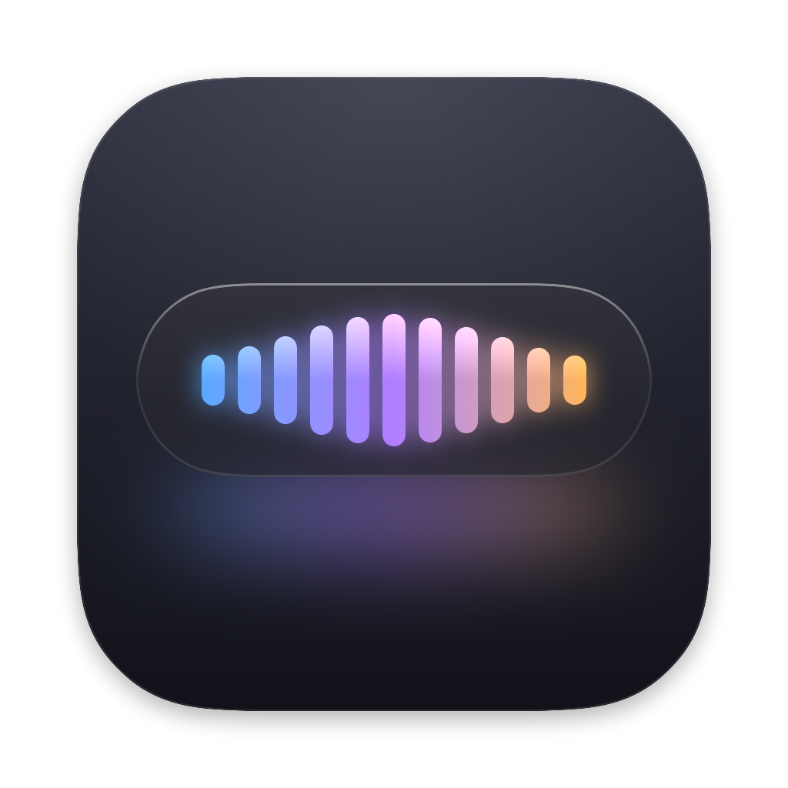

# VoiceStack



Talk to a coding agent out loud, from a floating pill on the Mac or a real phone call on the iPhone. You speak,
your words show up as live captions, a pause sends the turn to the agent session, and the reply is read back to you.
The agent can also ring you when it needs a decision.

**Status: a development build that works on my own Mac and iPhone. It is not a finished product.** Background
ringing on the iPhone is not possible yet (there is no real push sender), and the speech services and the agent
are things you bring yourself. See [what works and what doesn't](#what-works-and-what-doesnt).

## Why this exists

The first VoiceStack was a Mac pill and an iPhone app bolted to one specific agent front end through a bridge on
the Mac. It worked, but every part knew too much about every other part: the phone knew about the bridge, the
bridge knew about the agent's session files, and the speech services were wired in by name.

This is a clean rebuild that splits it into three parts with a written contract between them:

```text
        captured audio, reply text                 final user text, reply text
 app ◀──────────────────────────▶ speech backend   app ◀──────────────────────▶ Switchboard ◀──▶ agent
     (strict OpenAI Realtime transcription             (pairing, calls, per-call text channel)
      subset and /v1/audio/speech)
```

- The **apps** own the call. They send audio straight to a speech backend and only ever send text to the server.
- **Switchboard** is the server. It pairs devices, rings them, pins each call to one agent conversation and relays
  text. Audio never passes through it.
- The **speech backend** is anything that implements the speech profile. Switchboard picks it and hands the app a
  short-lived credential (a minute by default) that is checked offline, so the backend never talks to Switchboard.

Any of the three can be replaced without touching the other two. The contract is in
[Docs/PROTOCOL.md](Docs/PROTOCOL.md), and the server's tests fail if the code and that document disagree.

## What is inside

| Path | What |
|---|---|
| `Apps/VoiceStack-macOS` | The Mac app: a floating pill that expands into captions and settings |
| `Apps/VoiceStack-iOS` | The iPhone app: CallKit calls, PushKit registration, speaker routing, Focus and quiet hours |
| `Apps/Shared` | The call model, audio engine and speech client both apps compile |
| `Packages/VoiceStackCore` | Swift package: wire types, Keychain pairing, call state, pause detection, speech segmenting |
| `Switchboard/` | The server and its connector CLI (Bun, TypeScript, no dependencies). It has [its own README](Switchboard/README.md) |
| `Backend/ModeAAdapter` | A speech backend for the Mac (Node): fronts a local Parakeet recognizer and a Breeze TTS gateway |
| `Development/` | A stub Switchboard and a fake speech backend, for the app tests and for running the apps with no server |
| `Fixtures/`, `Tests/` | Contract fixtures, the Node tests and the native checks |
| `Docs/` | [PROTOCOL.md](Docs/PROTOCOL.md) and [INTEGRATION.md](Docs/INTEGRATION.md) (credential format, renewal, audio limits) |

## Build and test

You need Xcode 27 with the macOS and iOS SDKs, Node 22 or later and Python 3. Bun is optional and only needed for
the Switchboard tests. Nothing here downloads or installs a speech model.

```sh
sh scripts/check.sh
```

That runs the Node tests, the Switchboard tests (if `bun` is on your `PATH`), the Swift package tests, regenerates
`VoiceStack.xcodeproj`, and builds both apps unsigned. Build output goes to `/private/tmp/voicestack-build`; set
`VOICE_BUILD_ROOT` to put it somewhere else on a local disk.

The Xcode project is generated by `scripts/generate-project.py` and has two schemes, `VoiceStack Mac` and
`VoiceStack iOS`. Run the script again after adding a source file. Both targets need macOS 27 or iOS 27.

To put the apps on a device, set `VOICESTACK_BUNDLE_PREFIX` to your own reverse-DNS prefix before generating (the
default is `com.example.voicestack`) and pass your own signing team to `xcodebuild`. No signing material is in the
repository. The iOS target declares microphone, VoIP and background audio, push and communication-notification
capabilities, so the provisioning profile has to include them.

Three more checks build the real app model into small command-line binaries and run it with no microphone, speaker
or network:

```sh
sh scripts/check-waveform.sh                          # audio levels reach the waveform during playback
sh scripts/build-native-check.sh --startup    # first launch before pairing
sh scripts/build-native-check.sh --listening  # automatic listening and Discard
```

Without a flag, `build-native-check.sh` builds a fourth binary that runs the same model against a live Switchboard
(pairing code on stdin, `VOICE_SWITCHBOARD_BASE` in the environment). It places a real call, so point it at a test
server. `scripts/verify-live-speech.mjs` does the same for three synthetic speech exchanges.

## Try it without a server

```sh
npm ci --ignore-scripts
npm run dev
```

This starts the stub Switchboard on loopback port 8847 and a fake speech backend on 8848, and prints two one-use
pairing codes. The stub's replies are canned and its "speech" is a generated tone, so it shows the call flow and
nothing about real audio.

The apps refuse plain HTTP. To pair a real device with the stubs, give them a certificate the device already
trusts with `VOICE_DEV_CERT` and `VOICE_DEV_KEY`, and set `VOICE_DEV_HOST` and `VOICE_DEV_BIND`. The tooling does
not install a root certificate or weaken TLS checks.

## Running it for real

There are three things to stand up, and two of them are not in this repository.

1. **Switchboard**, next to your agent. See [Switchboard/README.md](Switchboard/README.md) and
   [Switchboard/docs/connector.md](Switchboard/docs/connector.md). The connector reaches the agent through a
   "lane". The one lane included was written for the agent runtime I run and has not been tested against anything
   else, so expect to write your own (it is one small interface).
2. **A speech backend.** `npm run adapter` starts the Mac adapter. It expects two local services that are *not
   included*: a Parakeet recognizer on `ws://127.0.0.1:8446/v1/transcribe` and a Breeze TTS gateway on
   `http://127.0.0.1:8444/v1/audio/speech`. The adapter converts 24 kHz audio to 16 kHz for the recognizer,
   checks every synthesized response really is 24 kHz mono PCM, and verifies the per-call credential with
   Switchboard's public key.

   | Variable | Meaning |
   |---|---|
   | `VOICE_TLS_CERT` / `VOICE_TLS_KEY` | Paths to the TLS certificate and private key |
   | `VOICE_VERIFY_KEY` | Path to Switchboard's Ed25519 public key (`switchboard backend key`) |
   | `VOICE_AUDIENCE` | The exact audience configured for this backend in Switchboard |
   | `VOICE_BIND` | A Tailscale or loopback address. Wildcard and public binds are rejected |
   | `VOICE_PORT` | Optional listener port, default 8448 |
   | `VOICE_BREEZE_VOICE` | Optional voice name, default `default` |
   | `VOICE_SETTINGS_FILE` | Optional file where the shared voice choice is kept |

   `scripts/install-mac-adapter.py` can run it as a LaunchAgent. `node scripts/probe-local-speech.mjs` checks the
   two local services with synthetic audio and prints format metadata only.
3. **A private network.** Everything assumes the apps, Switchboard and the speech backend reach each other over
   TLS on a private network. I use Tailscale; nothing is meant to sit on a public address.

Then print a pairing code on the server (`switchboard pairing-code`) and type it into each app.

## What works and what doesn't

Checked by hand, on one Mac and one iPhone:

- Pairing both apps with the server.
- An outgoing call from each app. On the iPhone it is a CallKit call.
- A spoken turn with live captions, then the agent's reply as a caption and as audio.
- Discard for words that have not been sent yet.

Covered by the automated tests, but not yet checked by hand on real devices:

- An agent ringing you with `switchboard-connector call`, and the first device to answer taking the call.
- Creating, revoking and deleting caller tokens.
- One shared voice choice for both devices, changed from either app or from the server's settings page.
- Renewing the speech credential during a long call without losing the call or a pending turn.

Does not work, or has not been checked:

- **No real push.** The server only has a stub APNs sender, so an iPhone cannot be rung in the background. The
  Mac shows an incoming call only while the app is open.
- **Half duplex.** You cannot talk over the reply. Steer is in the protocol, but the included lane answers every
  Steer as Queue.
- **Focus.** The iPhone publishes calls-enabled, quiet hours and what Apple's public Focus API reports. That API
  only shows what the app is allowed to see, so an unknown state is treated as "do not ring". Lock-screen and
  background behaviour have not been through proper device testing.
- **The cloud speech profile** in Switchboard has only run against a fake transport, never the real API.
- **One speech backend.** The profile is meant to be interchangeable, but only the Mac adapter has been used.
- **One person, one setup.** Long calls, flaky networks, a second user and a second agent runtime are untested.
- There is no conversation history in the apps (captions show the current exchange only) and no installable
  build.

## Credits

- The speech profile borrows event names and request shapes from OpenAI's Realtime transcription API and
  `/v1/audio/speech`. It is a strict subset, and it does not claim to work with OpenAI's SDKs.
- The Mac adapter depends on [`ws`](https://github.com/websockets/ws) (MIT), installed by npm.
- Parakeet, Breeze TTS, Tailscale, CallKit and PushKit belong to their owners. None of their code or models is in
  this repository.
- The pill design, the icon and the pause-detection approach come from the earlier VoiceStack release.
